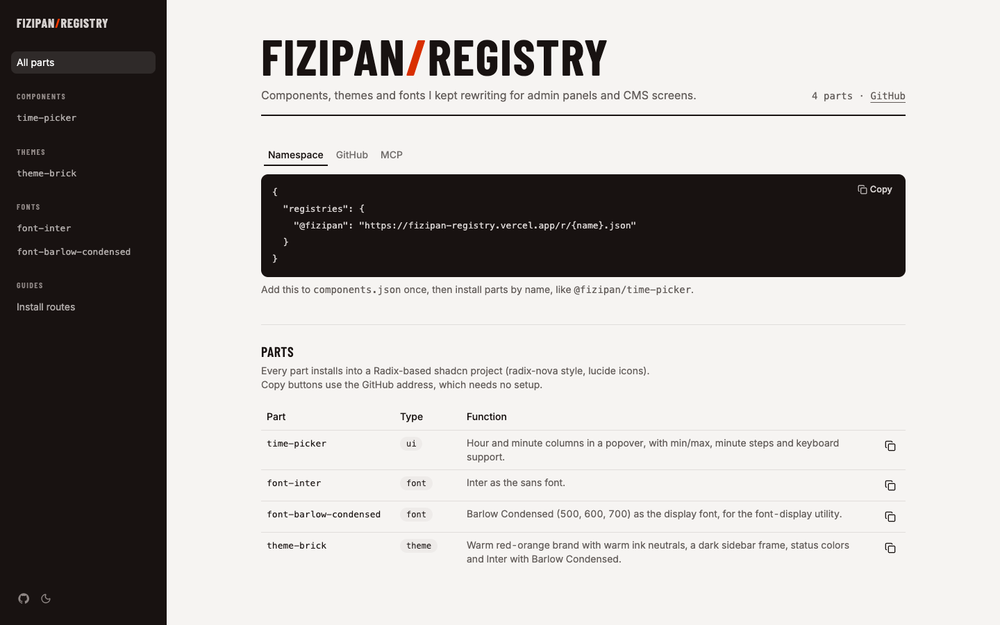
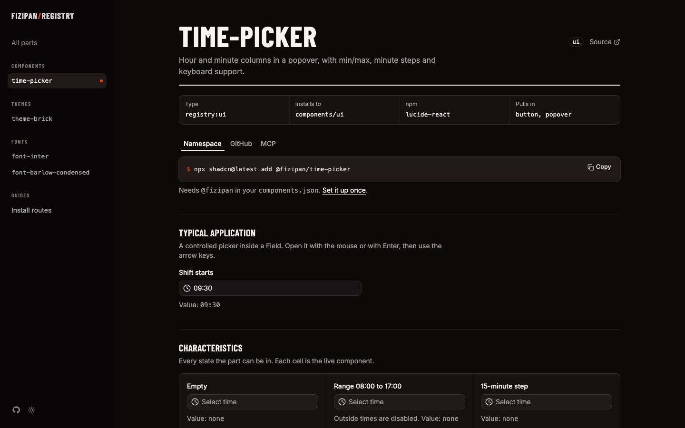

# fizipan/registry

shadcn/ui parts I kept rewriting across admin panels and CMS screens, written once: components, a theme and its fonts. They install with the shadcn CLI, so the source ends up in your repo and is yours to change.

**Docs and live previews:** https://fizipan-registry.vercel.app



## Parts

| Part                                                                                   | Type  | What it does                                                                               |
| -------------------------------------------------------------------------------------- | ----- | ------------------------------------------------------------------------------------------ |
| [`time-picker`](https://fizipan-registry.vercel.app/#/time-picker)                     | ui    | Hour and minute columns in a popover, with min/max, minute steps and keyboard support.     |
| [`admin-shell`](https://fizipan-registry.vercel.app/#/admin-shell)                     | block | Sidebar, header and user menu frame for admin panels. Works with any router.               |
| [`page-header`](https://fizipan-registry.vercel.app/#/page-header)                     | ui    | Page title row with an optional count badge, description and actions.                      |
| [`theme-brick`](https://fizipan-registry.vercel.app/#/theme-brick)                     | theme | Brick-red brand, warm neutrals, a dark sidebar, status colors, Inter and Barlow Condensed. |
| [`font-inter`](https://fizipan-registry.vercel.app/#/font-inter)                       | font  | Inter as the sans font.                                                                    |
| [`font-barlow-condensed`](https://fizipan-registry.vercel.app/#/font-barlow-condensed) | font  | Barlow Condensed (500, 600, 700) for the `font-display` utility.                           |

Each page has the install commands, a live preview, and the full reference: props and keyboard for components, every token for themes, weights and setup for fonts.



## Install

Parts are written for Radix-based shadcn projects (the `radix-nova` style, lucide icons). Themes and fonts expect Tailwind v4.

### From GitHub

No setup:

```bash
npx shadcn@latest add fizipan/registry/time-picker
```

### With the `@fizipan` namespace

Add the registry to `components.json` once:

```json
{
  "registries": {
    "@fizipan": "https://fizipan-registry.vercel.app/r/{name}.json"
  }
}
```

Then install by name, or see everything that's there:

```bash
npx shadcn@latest add @fizipan/time-picker
npx shadcn@latest search @fizipan
```

### From Claude Code (MCP)

With the namespace set up, run this in your project and restart Claude Code:

```bash
npx shadcn@latest mcp init --client claude
```

Then ask for a part by name, for example "add the time picker from @fizipan to the booking form".

## Development

```bash
pnpm install
pnpm dev              # docs site with live previews
pnpm test             # unit tests
pnpm registry:build   # writes public/r/*.json
pnpm build            # registry and site, as deployed
```

The site deploys to Vercel on every push to `main`, and the registry JSON is served from the same deployment.

To add a part:

1. Put its source in `src/registry/<name>/`.
2. Add an entry to `registry.json`.
3. Add its page in `src/docs/pages/`.

A test fails while a registry item has no page.

## License

MIT
